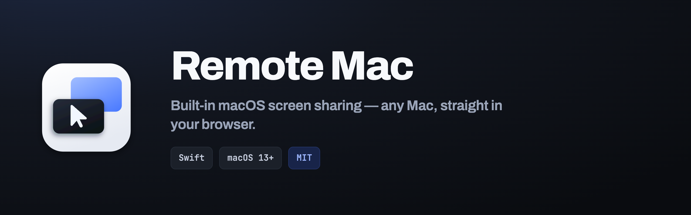
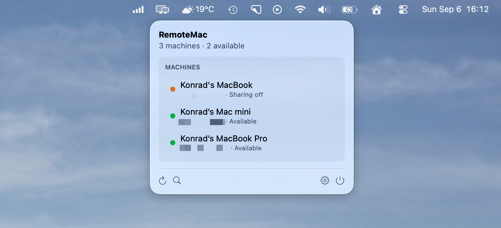
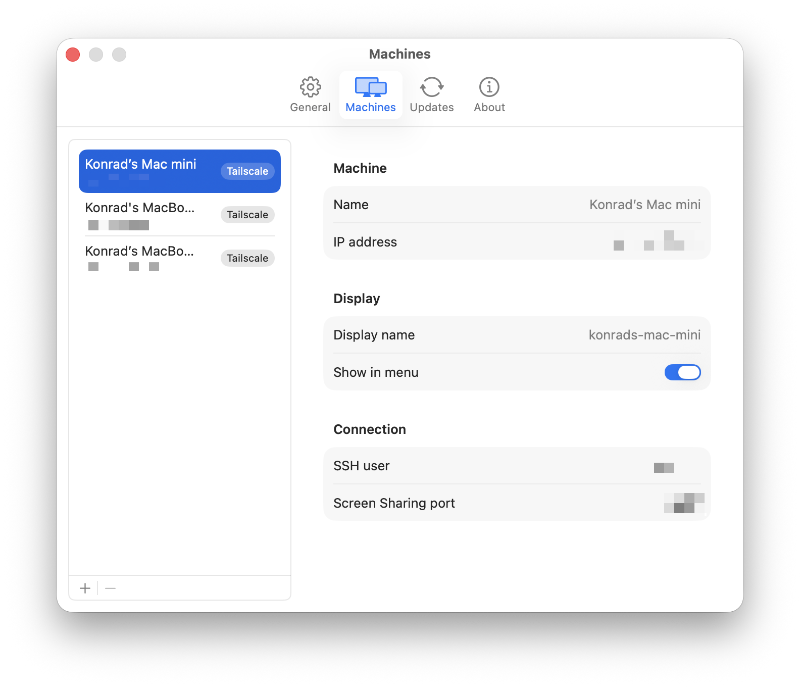
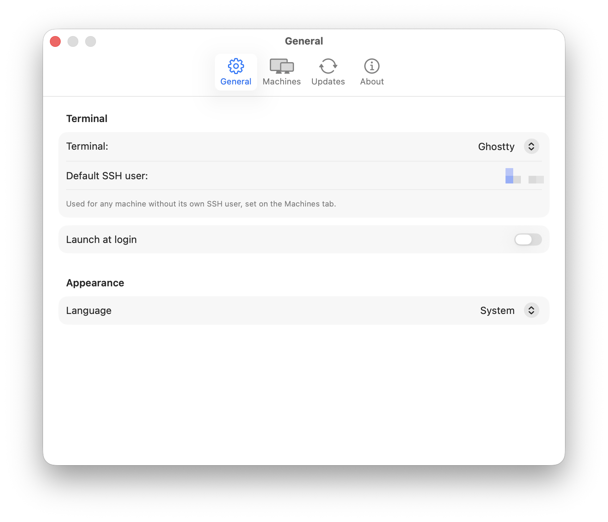

A macOS menu bar app that lists the Macs on your [Tailscale](https://tailscale.com)
tailnet by name instead of by IP, and gets you into them with one click — Screen
Sharing or an SSH session in your terminal of choice.

It replaces the ritual of opening Finder, hitting `⌘K`, and typing (or
remembering) an IP address. RemoteMac does not reimplement VNC or SSH — it
just points macOS's own Screen Sharing and your terminal at the right
address.

[](LICENSE)
[](#requirements)

## How it looks

**The menu bar panel** — your tailnet's Macs by name, with live status dots:



**Per-device settings** — override the display name, SSH user, and Screen
Sharing port for any device, or add machines manually:



**General settings** — pick the terminal SSH opens in, set the fallback SSH
user, and choose the interface language:



## Features

- **Automatic Tailscale discovery** — every Mac on your tailnet shows up by
  name, no configuration required.
- **Manual hosts** — add machines that aren't on your tailnet by name and
  address.
- **Per-device settings** — SSH user, display name, Screen Sharing port, and
  show/hide, all overridable per machine.
- **Status at a glance** — a dot per device: available, sharing off, offline,
  or not found.
- **One-click Screen Sharing** — opens macOS's built-in Screen Sharing app.
- **No password prompt** — reuses the password Screen Sharing remembered in
  your Keychain.
- **Automatic connection type** (opt-in, needs Accessibility) — High
  Performance on the same local network, Standard elsewhere, overridable per
  Mac.
- **SSH in your terminal** — Ghostty, iTerm2, Terminal, or Warp; only the
  ones actually installed on your Mac show up as options.
- **Copy IP / open SMB** — quick actions for when you need the raw address or
  a Finder connection instead.
- **Shared monitor switch** — when several Macs sit on one monitor, set
  each one's input in Settings → Machines and a button in its row switches
  the monitor to it over DDC. Needs [`m1ddc`](https://github.com/waydabber/m1ddc)
  (`brew install m1ddc`) on every Mac on the monitor and SSH key access to
  the remote ones.
- **Quick connect** — a Spotlight-style window to search and connect without
  touching the menu.
- **Background refresh** — statuses update every 30 seconds, so the dots are
  current before you even open the menu.
- **English and Polish**, following your Mac's language or a manual override.
- **Launch at login.**

## Requirements

- macOS 15 or newer
- [Tailscale](https://tailscale.com) (App Store or standalone build — either
  works)
- Screen Sharing enabled on the Macs you want to reach (System Settings →
  General → Sharing → Remote Management or Screen Sharing)

## Install

```bash
brew install --cask radnok/tap/remote-mac
```

Betas (signed and notarized, but not offered through auto-update):

```bash
brew install --cask radnok/tap/remote-mac@beta
```

The two casks conflict — `brew uninstall --cask remote-mac` first. Once a
stable release catches up, the beta cask points at it too.

Or grab the `.zip` from
[Releases](https://github.com/radnok/remote-mac/releases) and drag
`RemoteMac.app` into `/Applications`.

The app is signed with a Developer ID certificate and, once notarization is
set up, will be notarized by Apple, so it opens without a Gatekeeper warning.
See [Releases](#releasing) below for the current state of that pipeline.

## Build from source

You'll need a Swift 6 toolchain (ships with recent Xcode). There's no Xcode
project — it's a Swift package.

```bash
swift test              # run the test suite (165 tests)
./Scripts/build-app.sh  # build, assemble, and sign the .app
open ~/Applications/RemoteMac.app
```

`Scripts/build-app.sh` builds a release binary, assembles the `.app` bundle,
embeds `Sparkle.framework` for auto-updates, and signs everything with the
Developer ID identity it finds in your keychain. If you have more than one it
will list them and ask you to pick:

```bash
SIGN_IDENTITY=<sha1> ./Scripts/build-app.sh
echo <sha1> > .signing-identity   # or save the choice; it's gitignored
```

## Configuration

Settings are stored as plain, pretty-printed JSON at:

```
~/Library/Application Support/io.eightlines.remotemac/settings.json
```

It's meant to be hand-editable — there's no proprietary format or binary
plist involved. Passwords are never stored there or anywhere else in the app;
Screen Sharing keeps its own credentials in the macOS keychain.

## Honest caveats

- **An open Screen Sharing port means the service is listening, not that
  login will succeed.** RemoteMac only checks TCP reachability — it cannot
  and does not verify credentials.
- **Warp can't be driven programmatically.** Its automation API refuses to
  submit commands, so for Warp, RemoteMac opens the app and copies the SSH
  command to your clipboard for you to paste.
- **The monitor switch can only work through the Mac the monitor is
  showing.** DDC does not reach a monitor from an inactive input, so
  RemoteMac sends the request through every Mac with an input set and one of
  them switches it. Apple Silicon only (`m1ddc`'s limit).
- **Terminal.app needs an Automation permission the first time** you use it
  from RemoteMac (macOS will prompt for it). Ghostty and iTerm2 don't require
  any extra permission.

## Releasing

Maintainers only. Pushing a `vX.Y.Z` tag runs
[`.github/workflows/release.yml`](.github/workflows/release.yml), which
builds, signs, notarizes, publishes a GitHub release, updates the
[Sparkle](https://sparkle-project.org) appcast on `gh-pages`, and bumps the
Homebrew cask. A tag with a suffix (`v1.2.0-beta.1`) becomes a GitHub
prerelease that only updates the `remote-mac@beta` cask and stays out of the
appcast. `Scripts/release.sh <version>` does the same thing locally.

Both need credentials that are not in this repo — a Developer ID certificate,
notarization credentials, and the Sparkle signing key.
`Scripts/setup-ci-secrets.sh` populates them as repository secrets.

## License

[MIT](LICENSE) © Konrad Alfaro
